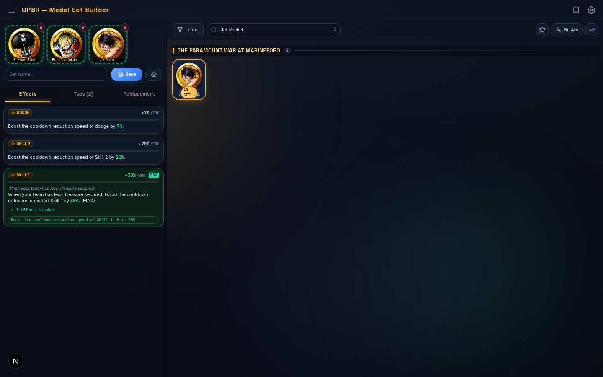
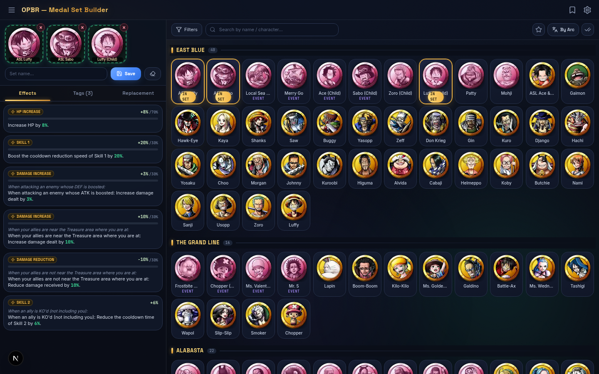

# OPBR Medal Set Builder

A fan-made medal set planning tool for **ONE PIECE Bounty Rush (OPBR)**. Browse all **710 medals** with authentic in-game stats, drop them into a 3-slot set, and instantly see merged effect stacking, tag set bonuses, and cost totals. Built as a modern rebuild of the community tool originally hosted at [ace-kyle.github.io/OPBR-medal-set-builder](https://ace-kyle.github.io/OPBR-medal-set-builder/).

**V2 "Treasure Obsidian" edition** — a full visual & motion overhaul: animated aurora background, glassmorphism panels, spring-physics interactions, and a redesigned effects panel with value/cap progress bars.





## Features

### Set Builder
- **3-slot set builder** — add medals by click or drag-and-drop, drag between slots, drag out to remove
- **Effect stacking engine** that replicates actual in-game rules:
  - Diminishing stacking: each duplicate effect after the first contributes `value − 1`
  - Per-effect **MAX caps** and condition-based limit conversion
  - Merged effect view showing every contributing medal and stack count
  - **Progress bars per effect** — value vs. cap (e.g. `+20% / 30%`) with animated spring fills, count-up values, and a pulsing **MAX** badge when capped
- **Tag set bonuses** — live tracker for 2-tag and 3-tag set bonuses with progress indicators
- **Replacement suggestions** — highlights other medals sharing tags with a slot
- **Saved sets** — save/load/rename/delete builds (persisted in your browser via localStorage)
- **JSON export** — download your marks, favorites, and sets

### Medal Browser
- **710 medals** with stats (HP / ATK / DEF), cost, abilities, and attach conditions
- **Filters** — by effect, condition, tag, and character
- **Search** — by medal or character name
- **Grouping modes** — By Arc (story saga), By Pirate/Navy, or flat list
- **Owned & favorite marks** — track your collection, batch marking mode, "marked only" view
- **Medal detail modal** — full stats, ability description, attach conditions, tags
- Fully responsive — desktop, tablet, and mobile (dark gold theme)

## Tech Stack

- **Next.js 16** (App Router) · **React 19** · **TypeScript**
- **Tailwind CSS 4** + **shadcn/ui** (Radix primitives)
- **Zustand** with persist middleware (localStorage)
- **Framer Motion** — spring physics, layout animations, staggered entrances
- **Typography** — Space Grotesk (display) · Inter (body) · JetBrains Mono (stats)
- Zero backend — the entire app runs client-side; no database, no API keys

### Design System ("Treasure Obsidian")

- Deep obsidian-navy base with slowly drifting **gold / teal / indigo aurora glows** (pure CSS, GPU-friendly)
- **Glassmorphism** panels (backdrop-blur + hairline borders)
- Treasure-gold primary, ocean-teal secondary, emerald stat values
- Spring physics everywhere: medal drop-in, tab indicator slide, slot pop, sheet/dialog/toast entrances
- Medal grid staggered entrance, hover lift + glow, shimmer on CTA buttons
- `prefers-reduced-motion` respected for accessibility

## Getting Started

### Prerequisites

- [Node.js 20+](https://nodejs.org/) (or [Bun](https://bun.sh/) 1.1+)

### Install & Run

```bash
# 1. Install dependencies
npm install        # or: bun install

# 2. Start the dev server
npm run dev        # or: bun run dev
```

Open [http://localhost:3000](http://localhost:3000) in your browser.

### Production Build

```bash
npm run build
npm run start      # serves the production build on :3000
```

### Lint

```bash
npm run lint
```

## Project Structure

```
opbr-medal-set-builder/
├── public/
│   └── img/medals/              # 710 medal icons (webp)
├── docs/                        # screenshots
├── src/
│   ├── app/
│   │   ├── layout.tsx           # root layout + metadata
│   │   ├── page.tsx             # main page (set builder + medal browser)
│   │   └── globals.css          # theme tokens, dark gold styling
│   ├── components/
│   │   ├── opbr/                # app components
│   │   │   ├── medal-card.tsx       # medal grid card
│   │   │   ├── medal-detail-modal.tsx
│   │   │   ├── effects-panel.tsx    # merged effects + stacking + caps
│   │   │   ├── tags-panel.tsx       # tag set bonus tracker
│   │   │   ├── replace-panel.tsx    # replacement suggestions
│   │   │   ├── saved-sets-panel.tsx # save/load builds
│   │   │   └── filter-panel.tsx     # effect/condition/tag/character filters
│   │   └── ui/                  # shadcn/ui primitives (only the used ones)
│   ├── lib/
│   │   ├── opbr/
│   │   │   ├── types.ts         # domain types
│   │   │   ├── data.ts          # data indexes, search, labels
│   │   │   ├── data/game-data.json  # full medal database (710 medals, 121 tags, 448 abilities)
│   │   │   ├── engine.ts        # set computation: stacking, caps, tag bonuses
│   │   │   └── store.ts         # zustand store + localStorage persistence
│   │   └── utils.ts
│   └── hooks/                   # use-hydrated, use-toast
├── next.config.ts
└── package.json
```

## How the Set Engine Works

- **Stacking rule**: when the same effect appears on multiple medals, the total is
  `sum(values) − (count − 1)` — matching the game's diminishing-returns stacking.
- **Limits**: attach conditions convert in-game limits via `limit / 100 + 1` where applicable.
- **Tag set bonuses**: equipping 2 or 3 medals sharing the same tag activates that tag's
  set bonus (displayed live in the tags panel with progress dots).
- All computation happens in [`src/lib/opbr/engine.ts`](src/lib/opbr/engine.ts) — pure
  functions, fully unit-testable.

## Data

- `src/lib/opbr/data/game-data.json` contains the complete database:
  **710 medals, 121 tags, 448 abilities, 199 characters, 18 effect types, 19 limit types**.
- Medal icons live in `public/img/medals/img_icon_medal_{id}.webp`.
- All user data (owned/favorite marks, saved sets, active slots) is stored in your
  browser's localStorage — nothing is uploaded anywhere.

## Deployment

Any Node.js host works:

- **Vercel** — import the repo, zero config
- **Netlify** — use the Next.js runtime
- **Self-hosted** — `npm run build && npm run start` (or containerize it)

## Credits & Disclaimer

- Original tool concept and data reference: [ace-kyle/OPBR-medal-set-builder](https://ace-kyle.github.io/OPBR-medal-set-builder/)
- This is a **fan-made, non-commercial** tool. Not affiliated with Bandai Namco or Shueisha.
- ONE PIECE and all related characters are trademarks of Eiichiro Oda / Shueisha / Toei Animation / Bandai Namco Entertainment.
